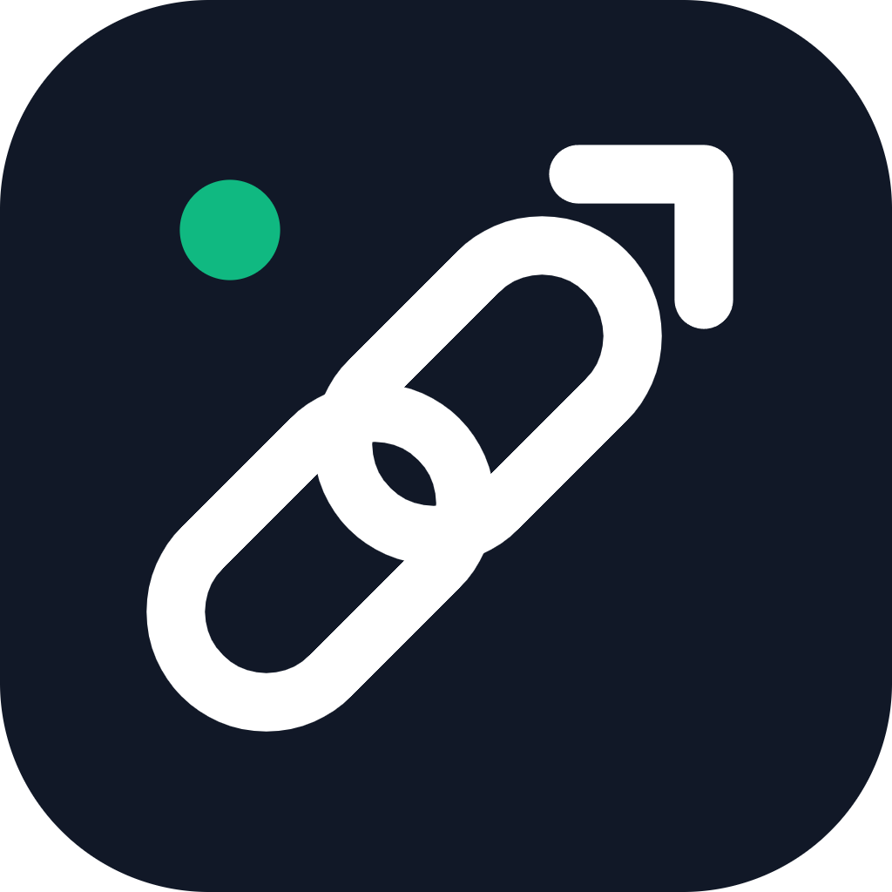
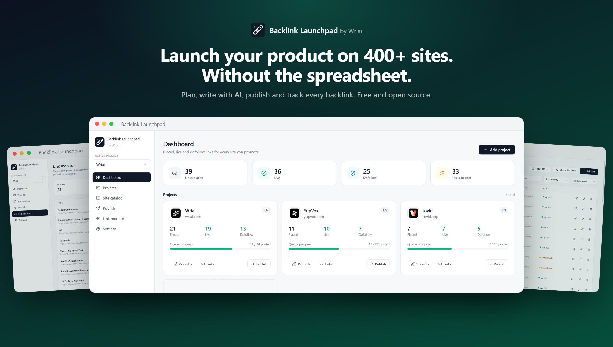
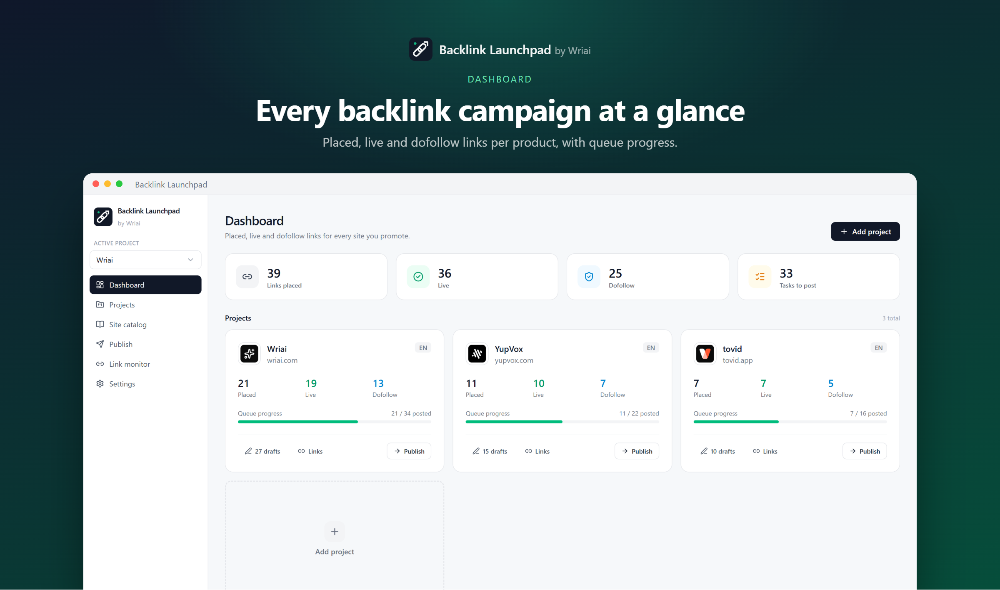
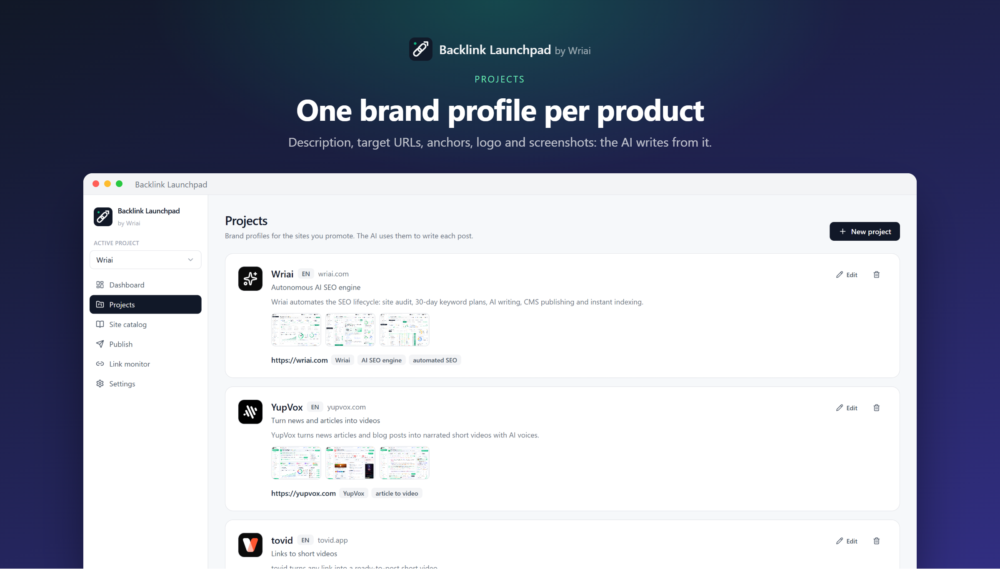
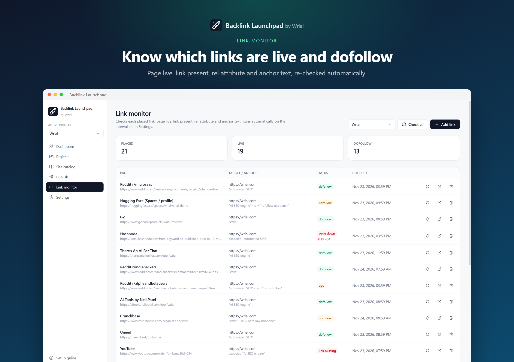
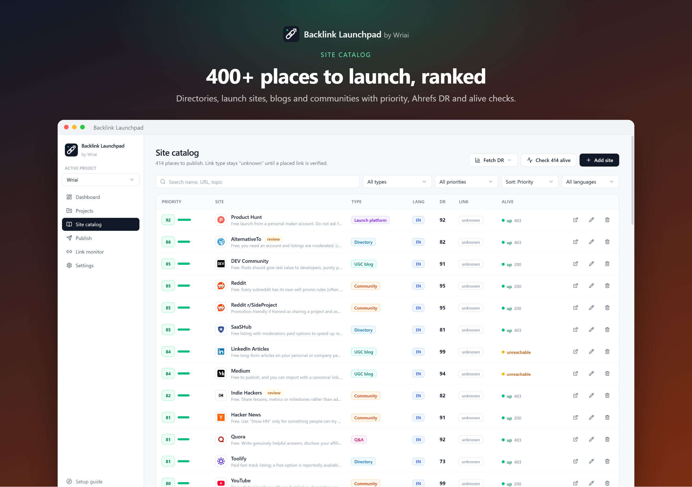
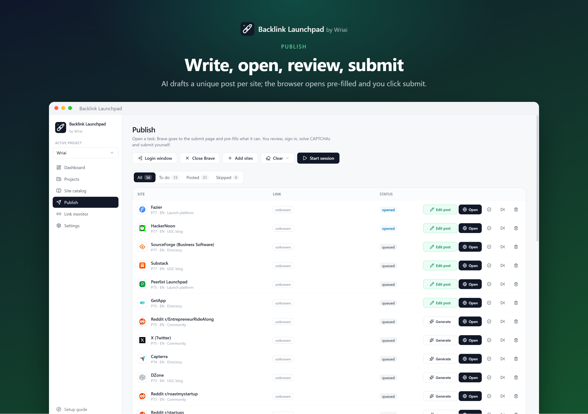

<p align="center">
  
</p>

<h1 align="center">Backlink Launchpad</h1>
<p align="center"><b>by <a href="https://wriai.com">Wriai</a></b> · plan, write and track launch posts and backlinks on 400+ directories and communities</p>

<p align="center">
  
</p>

Backlink Launchpad is a free desktop app for founders and marketers who promote a product by listing it on directories,
launch sites, blogs and communities. It is a **campaign manager and posting assistant, not a spam bot**: it prepares
everything, and you review and click submit yourself.

## What it does

| | |
| --- | --- |
| **Site catalog** | 414 places to publish: AI/SaaS directories, launch platforms, UGC blogs, communities, forums, Q&A (English and Vietnamese). Each has a priority score (0-100), Ahrefs DR (one click, free), type, language, link rules and an alive check. |
| **Projects** | A brand profile per product: description, target URLs with anchor texts, logo and screenshots. |
| **AI writing** | On the Publish page, one click writes a unique, value-first post per site, in that site's language, length and format (HTML, Markdown or plain text). WYSIWYG editor, preview, Regenerate with your own instructions, and PDF export (for Yumpu, Issuu, Scribd, SlideShare). |
| **Publish** | Opens each submit page in a separate browser profile, fills title and body, attaches logo and screenshots. **Start session** walks the queue by priority and saves the live post URL automatically when you publish (with Undo). |
| **Link monitor** | Re-checks every placed link: page live, link present, `rel` (dofollow, nofollow, ugc, sponsored), anchor text. |

## Screenshots

| | |
| --- | --- |
|  |  |
|  |  |
|  | |

## Responsible use

The app **never submits a form, never solves a CAPTCHA and never creates an account**. You sign in, review every post,
and press submit. Read each community's rules (most subreddits ban self-promotion), disclose that you are the maker,
post value first, and spread posts out over time. Spammy posting gets accounts banned and hurts your domain.

## Install

1. Download the installer for your system from the [latest release](../../releases/latest):
   - Windows: `Backlink-Launchpad-Setup-x.y.z.exe`
   - macOS: `Backlink-Launchpad-x.y.z-arm64.dmg` (Apple silicon) or `-x64.dmg` (Intel)
   - Linux: `Backlink-Launchpad-x.y.z-x86_64.AppImage`
2. The builds are not code-signed yet:
   - Windows SmartScreen: click **More info**, then **Run anyway**.
   - macOS: right-click the app, choose **Open**, then **Open** again.
   - Linux: `chmod +x Backlink-Launchpad-*.AppImage`, then run it.
3. Install a Chromium browser if you do not have one. **Brave** is recommended; Chrome and Edge work too.

## First run

A setup guide opens on first launch (reopen it any time from **Setup guide** in the sidebar):

1. **Browser**: found automatically, or set its path.
2. **AI writing**: choose one:
   - **Wriai API** (recommended): paste the API key from your [Wriai account](https://wriai.com/dashboard/api-docs).
     Generation is billed in Wriai credits by characters written. API keys need an active paid Wriai plan.
   - **OpenAI-compatible**: your own endpoint, model and key (OpenAI, OpenRouter, a gateway or a local model).
3. **Sign in** to the sites you will use, in the app's own browser profile. Logins are remembered.
4. **Create a project**, add 10-30 high-priority sites on the Publish page, generate posts, and start a session.

Optional: add an Ahrefs API key in Settings to fill the DR column (uses the free DR endpoint, 0 API units).
Once a site's DR is known, its priority becomes 70% the researched score and 30% DR; a priority you edit by hand is kept.

## Your data

Everything stays on your computer:

| How the app runs | Data folder |
| --- | --- |
| Installed app | Windows `%APPDATA%\BacklinkBuilder`, macOS `~/Library/Application Support/BacklinkBuilder`, Linux `~/.config/BacklinkBuilder` |
| `pnpm dev` | `<repo>/data` (gitignored) |
| `BB_USER_DATA=<dir>` | that folder (used by tests) |

The folder holds the SQLite database, the browser profile with your logins (cookies) and cached favicons.
Back it up to keep your projects; never share it, because it contains your sessions.

## Build from source

Requirements: Node 22+, pnpm 10.

```bash
pnpm install
cp .env.example .env   # optional: keys for development
pnpm dev               # run the app
pnpm typecheck         # tsc for main/preload/core and renderer
pnpm test              # post URL detection + catalog validation
pnpm build:win         # or build:mac / build:linux -> installers in release/
```

Pushing a tag like `v0.2.0` runs `.github/workflows/release.yml`, which builds all three platforms and attaches them to
a draft GitHub Release.

### Environment variables (optional, all can be set in the app instead)

| Variable | Meaning |
| --- | --- |
| `WRIAI_API_KEY` | Wriai API key (`wri_live_...`) for the Wriai provider |
| `WRIAI_API_BASE` | Override the Wriai AI endpoint (default `https://wriai.com/api/v1/ai`, see [docs/wriai-ai-api.md](docs/wriai-ai-api.md)) |
| `OPENAI_END_POINT`, `OPENAI_API_KEY`, `OPENAI_TEXT_MODEL` | OpenAI-compatible provider; models separated by `\|` |
| `OPENAI_END_POINT_BK_1`, `OPENAI_API_KEY_BK_1`, `OPENAI_TEXT_MODEL_BK_1` | Fallback gateway |
| `OPENAI_TIMEOUT_MS` | Request timeout (default 120000) |
| `AHREFS_API_KEY` | Ahrefs key for Fetch DR |

## Contributing to the catalog

The catalog is one file: [`catalog/sites.json`](catalog/sites.json). To add or fix a site, edit it and run `pnpm test`
(checks required fields, allowed values, https URLs and duplicates). Fields:

```jsonc
{
  "name": "Product Hunt",
  "url": "https://www.producthunt.com",
  "submitUrl": "https://www.producthunt.com/posts/new",
  "type": "launch",              // directory | launch | ugc_blog | community | forum | qa
  "language": "en",              // en | vi
  "priority": 92,                // 0-100: relevance, cost/effort, link value (blended 70/30 with DR in the app)
  "format": "plain",             // plain | markdown | html (what the site's editor accepts)
  "topics": ["startup", "saas"],
  "rules": "One or two sentences: free/paid, moderation, link policy.",
  "needsReview": true,           // optional: submit URL or policy not verified yet
  "maxLength": 500               // optional: body length limit in characters
}
```

Do not claim dofollow/nofollow without checking a real placed link; the app learns it from the link monitor.
After adding sites, bump `CATALOG_VERSION` in `src/core/catalogSeed.ts` so existing installs pick them up.

## Code layout

```
catalog/        sites.json (the catalog)
src/core/       portable logic, no Electron: ai.ts, contentGen.ts, linkAnalysis.ts, postDetect.ts, ahrefs.ts, catalogSeed.ts
src/main/       Electron main: db/, repo.ts, ipc.ts, browser.ts, session.ts, tasks.ts, checker.ts, drScan.ts, pdf.ts, favicon.ts
src/preload/    typed IPC bridge (window.api)
src/shared/     types shared by all layers, including the IPC contract
src/renderer/   React + Tailwind UI
resources/      logo.svg (source of build/icon.png)
docs/           Wriai AI API contract, screenshots
```

## License

[MIT](LICENSE) © 2026 Wriai. Site names and logos in the catalog belong to their owners.

Domain Rating by [Ahrefs](https://ahrefs.com/). DR is fetched on each user's machine with their own Ahrefs key, under the
[Ahrefs DR license](https://ahrefs.com/legal/domain-rating-license); the catalog file must not contain DR values
(bulk redistribution is not allowed).
