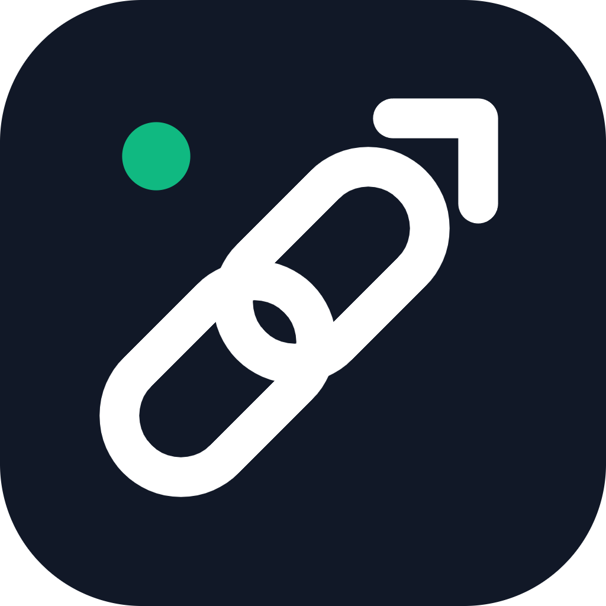
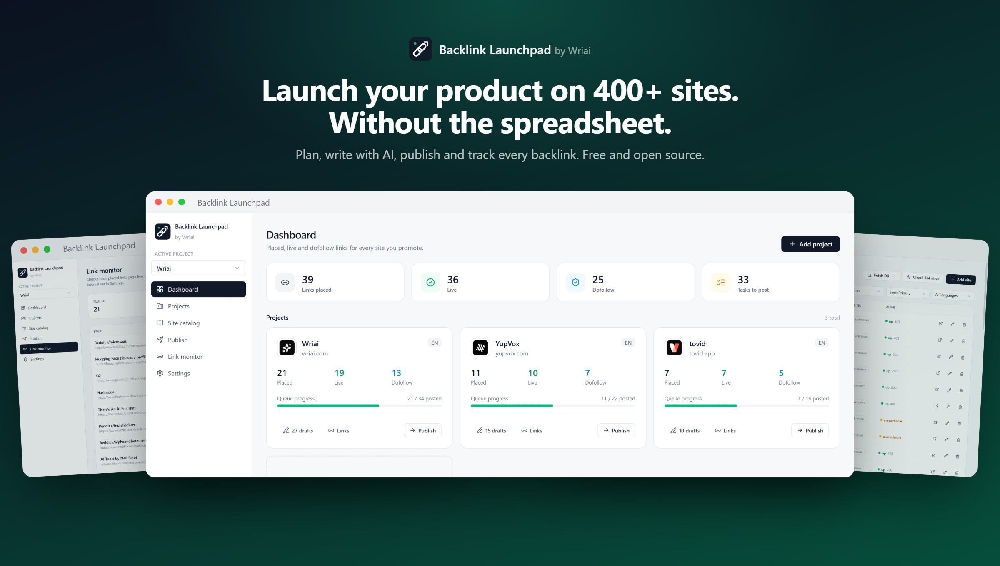
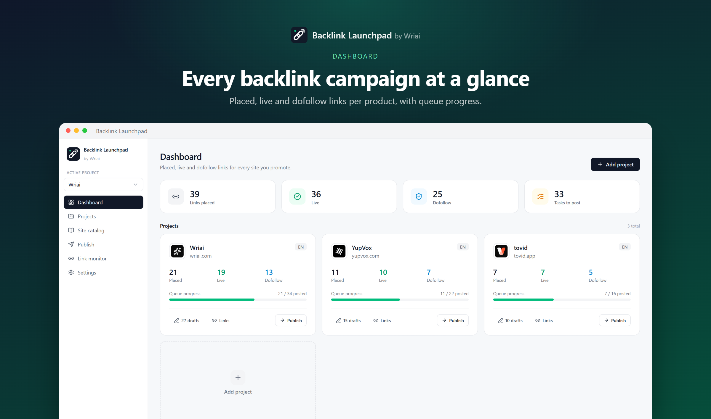
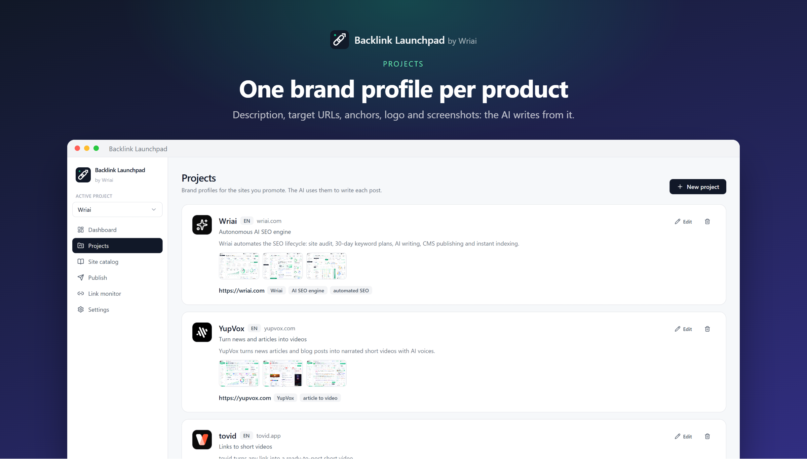
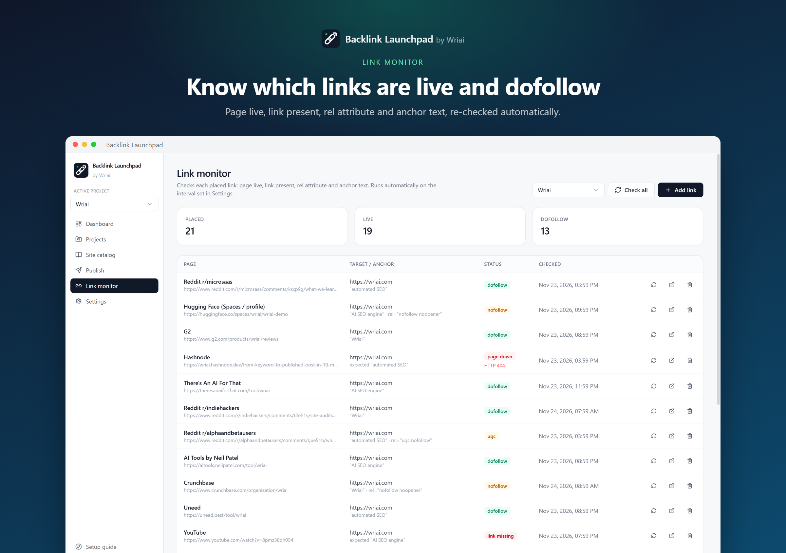
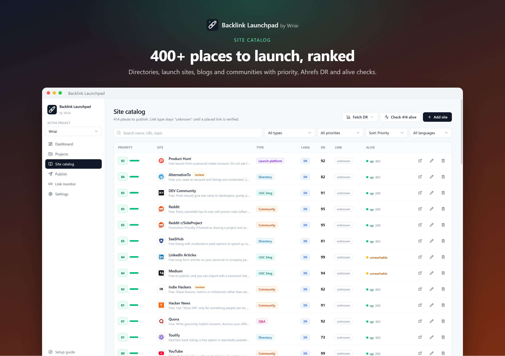
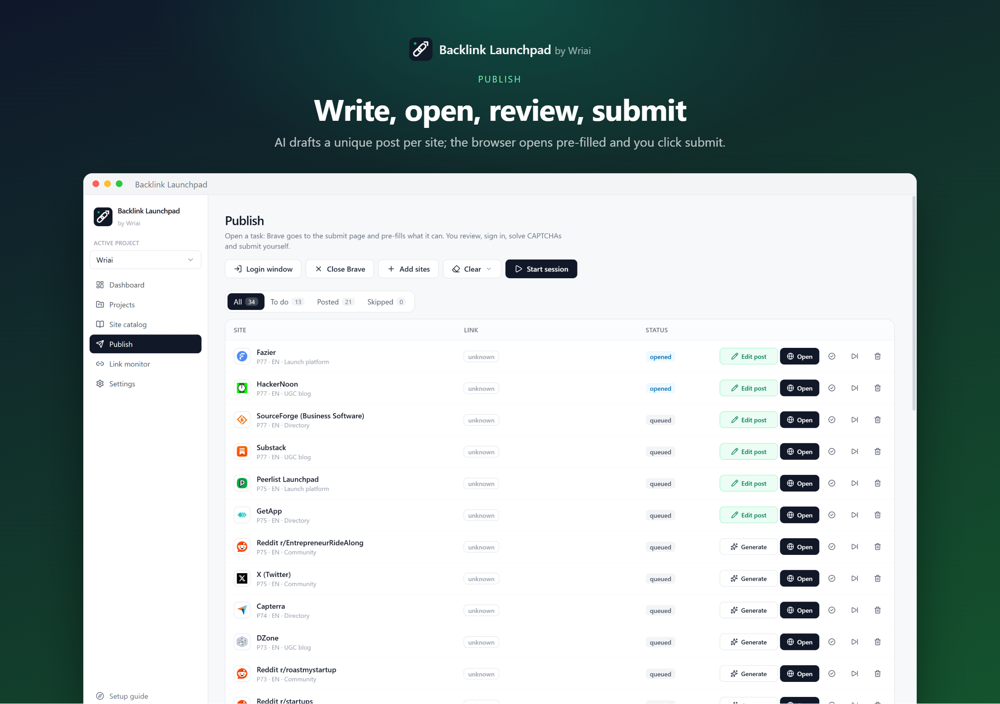

<p align="center">
  
</p>

<h1 align="center">Backlink Launchpad</h1>
<p align="center"><b>by <a href="https://wriai.com">Wriai</a></b> · lên kế hoạch, viết bài và theo dõi backlink trên hơn 500 directory, launch site và cộng đồng</p>

<p align="center">
  <a href="https://github.com/BoxiBoxi/backlink-launchpad/releases/latest"></a>
  <a href="https://github.com/BoxiBoxi/backlink-launchpad/releases"></a>
  <a href="https://github.com/BoxiBoxi/backlink-launchpad/actions/workflows/ci.yml"></a>
  <a href="LICENSE"></a>
  
  <a href="https://github.com/BoxiBoxi/backlink-launchpad/stargazers"></a>
</p>
<p align="center">
  
  
  
  
  
  
</p>

<p align="center">
  <a href="https://github.com/BoxiBoxi/backlink-launchpad/releases/latest"></a> <a href="https://github.com/BoxiBoxi/backlink-launchpad/releases/latest"></a> <a href="https://github.com/BoxiBoxi/backlink-launchpad/releases/latest"></a>
</p>

<p align="center"><a href="README.md">English</a> · <b>Tiếng Việt</b></p>

<p align="center">
  <a href="https://www.youtube.com/watch?v=zBqhcdakRWQ"></a>
  <br /><sub>▶ <a href="https://www.youtube.com/watch?v=zBqhcdakRWQ">Xem video hướng dẫn trên YouTube</a></sub>
</p>

<p align="center">
  
</p>

Backlink Launchpad là ứng dụng desktop miễn phí cho founder và người làm marketing muốn quảng bá sản phẩm bằng cách đăng
lên các directory, launch site, blog và cộng đồng. Đây là **công cụ quản lý chiến dịch và trợ lý đăng bài, không phải bot
spam**: app chuẩn bị sẵn mọi thứ, còn bạn là người kiểm tra và bấm đăng.

## Tính năng

| | |
| --- | --- |
| **Site catalog** | 414 nơi để đăng: directory AI/SaaS, launch platform, blog UGC, cộng đồng, forum, hỏi đáp (tiếng Anh và tiếng Việt). Mỗi site có điểm ưu tiên (0-100), Ahrefs DR (một cú bấm, miễn phí), loại, ngôn ngữ, quy định về link và trạng thái còn sống. |
| **Projects** | Hồ sơ thương hiệu cho từng sản phẩm: mô tả, URL cần đặt link kèm anchor text, logo và ảnh chụp màn hình. |
| **Viết bài bằng AI** | Trong trang Publish, một cú bấm là AI viết một bài riêng, có giá trị cho từng site, đúng ngôn ngữ, độ dài và định dạng của site đó (HTML, Markdown hoặc văn bản thường). Có trình soạn thảo trực quan, xem trước, Regenerate theo hướng dẫn của bạn, và xuất PDF (cho Yumpu, Issuu, Scribd, SlideShare). |
| **Publish** | Mở trang đăng bài của từng site trong một profile trình duyệt riêng, điền sẵn tiêu đề và nội dung, đính kèm logo và ảnh. **Start session** đi lần lượt theo độ ưu tiên và tự lưu link bài khi bạn đăng xong (có Undo). |
| **Link monitor** | Kiểm tra lại từng link đã đặt: trang còn sống không, link còn không, `rel` (dofollow, nofollow, ugc, sponsored), anchor text. |

## Ảnh chụp màn hình

| | |
| --- | --- |
|  |  |
|  |  |
|  | |

## Dùng có trách nhiệm

App **không bao giờ tự bấm gửi form, không giải CAPTCHA và không tạo tài khoản**. Bạn tự đăng nhập, đọc lại từng bài và tự
bấm đăng. Hãy đọc quy định của từng cộng đồng (đa số subreddit cấm tự quảng cáo), nói rõ bạn là người làm ra sản phẩm, ưu
tiên chia sẻ giá trị, và rải bài ra theo thời gian. Đăng kiểu spam sẽ bị khóa tài khoản và làm hại domain của bạn.

## Cài đặt

1. Tải bản cài cho máy của bạn ở [bản phát hành mới nhất](../../releases/latest):
   - Windows: `Backlink-Launchpad-Setup-x.y.z.exe`
   - macOS: `Backlink-Launchpad-x.y.z-arm64.dmg` (chip Apple M1 đến M4) hoặc `-x64.dmg` (Mac Intel)
   - Linux: `Backlink-Launchpad-x.y.z-x86_64.AppImage`
2. Bản cài chưa được ký số:
   - Windows SmartScreen: bấm **More info**, rồi **Run anyway**.
   - macOS: chuột phải vào app, chọn **Open**, rồi **Open** lần nữa. Nếu macOS báo app bị hỏng ("damaged"), chạy
     `xattr -cr "/Applications/Backlink Launchpad.app"` một lần.
   - Linux: `chmod +x Backlink-Launchpad-*.AppImage` rồi chạy.
3. App dùng Brave, Chrome hoặc Microsoft Edge, cái nào có sẵn thì dùng (Windows luôn có Edge).

Trên Windows và Linux, app tự cập nhật: kiểm tra GitHub khi mở và mỗi 6 giờ, tải bản mới chạy nền rồi hiện nút
**Restart to update** (thoát app cũng tự cài). Trên macOS app báo có bản mới và mở trang tải. Đóng cửa sổ thì app vẫn
chạy dưới khay hệ thống (tray) để Link monitor tiếp tục kiểm tra; chọn **Quit** trong menu tray để thoát (tắt được
trong Settings).

## Lần chạy đầu tiên

Lần đầu mở app sẽ có trình hướng dẫn cài đặt (mở lại bất cứ lúc nào ở nút **Setup guide** trên sidebar):

1. **Trình duyệt**: app tự tìm, hoặc bạn nhập đường dẫn.
2. **Viết bài bằng AI**: chọn một trong hai:
   - **Wriai API** (khuyên dùng): dán API key từ [tài khoản Wriai](https://wriai.com/dashboard/api-docs). Tính phí bằng
     credit Wriai theo số ký tự viết ra. API key cần tài khoản Wriai có gói trả phí đang hoạt động.
   - **OpenAI-compatible**: endpoint, model và key của riêng bạn (OpenAI, OpenRouter, gateway hoặc model chạy local).
3. **Đăng nhập** các site bạn sẽ dùng, trong profile trình duyệt riêng của app. Đăng nhập một lần là app nhớ.
4. **Tạo project**, thêm 10-30 site ưu tiên cao ở trang Publish, tạo bài, rồi bấm Start session.

Tùy chọn: thêm Ahrefs API key trong Settings để lấy cột DR (dùng endpoint DR miễn phí, không tốn API unit). Khi đã có DR,
điểm ưu tiên của site là 70% điểm nghiên cứu và 30% DR; điểm bạn tự sửa thì được giữ nguyên.

### Extension trình duyệt: tự điền form

Nút **Open** trong trang Publish mở trang đăng bài trong cửa sổ trình duyệt bình thường, nên các bước kiểm tra chống bot
như Cloudflare đều qua. **Extension Backlink Launchpad** tự điền form ở đó và hiện một bảng nhỏ để điền lại, copy tiêu đề
hoặc nội dung, và lưu link bài sau khi bạn đã đăng. Bạn vẫn tự xem lại và tự bấm submit.
Brave và Microsoft Edge tự nạp extension. Chrome cần thêm extension một lần (Settings > Browser extension có hướng dẫn).

Extension cũng tự điền **form đăng ký và đăng nhập** trên các site trong catalog, giống trình quản lý mật khẩu: thông tin lấy từ
**Settings > Sign-up profile**, mỗi site có một mật khẩu mạnh riêng, được mã hoá bằng kho bảo mật của máy
(**Settings > Saved accounts** để copy lại khi cần). Extension không bao giờ tick ô đồng ý điều khoản và không bấm nút đăng ký.

**Form memory:** những gì bạn gõ vào form submit (tagline, pricing, category, link mạng xã hội...) được ghi nhớ theo project
và tự điền vào các ô cùng nghĩa ở site tiếp theo, kể cả khi tên ô khác nhau. Ô nào chưa chắc chắn thì hiện thành gợi ý trên
trang. Xem, sửa hoặc xoá giá trị đã nhớ ở **Projects > Form memory**. Mật khẩu, số thẻ, mã xác nhận và API key không bao giờ
được ghi nhớ.

**Form recipes và chia sẻ:** extension còn ghi nhớ *ô nào có nghĩa gì* trên từng site (ví dụ ô `#pitch` trên betalist.com
là tagline). Recipe không chứa dữ liệu cá nhân nên có thể chia sẻ: [catalog/forms.json](catalog/forms.json) đi kèm app, và
**Settings > Browser extension > Form recipes > Export** tạo file để gửi cho team hoặc đóng góp vào `catalog/forms.json`
qua pull request. Giá trị đã nhớ của một project cũng export và import được (**Projects > Form memory**), để làm chung một
đợt launch với đồng đội.

## Dữ liệu của bạn

Mọi thứ nằm trên máy của bạn:

| Cách chạy app | Thư mục dữ liệu |
| --- | --- |
| App đã cài | Windows `%APPDATA%\BacklinkBuilder`, macOS `~/Library/Application Support/BacklinkBuilder`, Linux `~/.config/BacklinkBuilder` |
| `pnpm dev` | `<repo>/data` (không commit) |
| `BB_USER_DATA=<dir>` | thư mục đó (dùng cho test) |

Thư mục này chứa database SQLite, profile trình duyệt có phiên đăng nhập (cookie) và favicon đã lưu. Hãy sao lưu để giữ
project; đừng chia sẻ thư mục này vì nó chứa phiên đăng nhập của bạn.

## Build từ mã nguồn

Yêu cầu: Node 22+, pnpm 10.

```bash
pnpm install
cp .env.example .env   # tùy chọn: key dùng khi phát triển
pnpm dev               # chạy app
pnpm typecheck         # kiểm tra kiểu cho main/preload/core và renderer
pnpm test              # test nhận link bài + kiểm tra catalog
pnpm build:win         # hoặc build:mac / build:linux -> bản cài trong release/
```

Phát hành: tăng `version` trong `package.json`, rồi push một tag như `v0.2.0`. `.github/workflows/release.yml` sẽ build cả 3
hệ điều hành và đính kèm bản cài, file `*.blockmap` và `latest*.yml` vào một GitHub Release nháp. Bấm **Publish** bản nháp
thì bản cập nhật mới được phát hành: app đã cài (từ 0.1.3 trở lên) sẽ nhận trong vòng 6 giờ hoặc ở lần mở tiếp theo. Danh sách biến môi trường xem trong [README tiếng Anh](README.md#environment-variables-optional-all-can-be-set-in-the-app-instead).

## Đóng góp vào catalog

Catalog nằm trong một file duy nhất: [`catalog/sites.json`](catalog/sites.json). Muốn thêm hoặc sửa site, sửa file này rồi
chạy `pnpm test` (kiểm tra trường bắt buộc, giá trị hợp lệ, URL https và trùng lặp). Các trường:

```jsonc
{
  "name": "Product Hunt",
  "url": "https://www.producthunt.com",
  "submitUrl": "https://www.producthunt.com/posts/new",
  "type": "launch",              // directory | launch | ugc_blog | community | forum | qa
  "language": "en",              // en | vi
  "priority": 92,                // 0-100: độ liên quan, công sức/chi phí, giá trị link (app trộn 70/30 với DR)
  "format": "plain",             // plain | markdown | html (định dạng trình soạn thảo của site nhận)
  "topics": ["startup", "saas"],
  "rules": "Một hai câu: miễn phí/trả phí, kiểm duyệt, chính sách link.",
  "needsReview": true,           // tùy chọn: link đăng bài hoặc chính sách chưa kiểm chứng
  "maxLength": 500               // tùy chọn: giới hạn độ dài nội dung (ký tự)
}
```

Đừng ghi dofollow/nofollow khi chưa kiểm tra một link thật; app tự biết điều đó qua Link monitor. Sau khi thêm site, tăng
`CATALOG_VERSION` trong `src/core/catalogSeed.ts` để các bản cài cũ nhận được site mới.

**Rất hoan nghênh anh em Việt Nam đóng góp thêm forum, blog và cộng đồng tiếng Việt** (`"language": "vi"`).

## Giấy phép

[MIT](LICENSE) © 2026 Wriai. Tên và logo các site trong catalog thuộc về chủ sở hữu của chúng.

Domain Rating by [Ahrefs](https://ahrefs.com/). DR được lấy trên máy của từng người dùng bằng Ahrefs key của họ, theo
[giấy phép DR của Ahrefs](https://ahrefs.com/legal/domain-rating-license); file catalog không được chứa giá trị DR (không
được phát tán hàng loạt).
